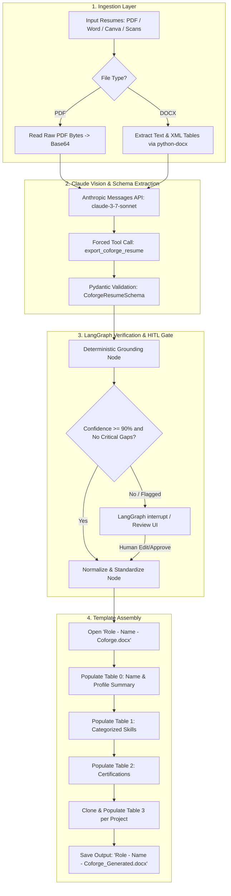

# Enterprise Resume Automation & Standardization System
## Production Architecture, Technical Specification & Implementation Blueprint

---

## 1. Executive Summary & Objective

### 1.1 The Business Problem
Coforge manages a large pool of consultant resumes across onshore and offshore practices. Incoming resumes arrive in wildly varying formats (multi-column PDFs, Canva designs, Word `.docx`, and scanned images) with disparate section naming conventions, inconsistent date styles, and decorative styling.

Today, converting these diverse profiles into the official corporate template ([`Role - Name - Coforge.docx`](file:///c:/Users/chity/Documents/ResumeAutomation/Role%20-%20Name%20-%20Coforge.docx)) is performed manually via copy-paste. This manual process is:
* **Slow and expensive**: 20–45 minutes per resume.
* **Error-prone**: High frequency of dropped bullets, misplaced dates, and distorted styling.
* **Inconsistent**: Varies depending on the individual recruiter or resource manager.

### 1.2 The Target Solution
An automated, deterministic pipeline that ingests any candidate resume, processes its layout and textual content using **Anthropic Claude (Claude 3.7 / 3.5 Sonnet)**, validates the structured extraction through **Pydantic** with zero-hallucination guardrails, orchestrates review checkpoints using **LangGraph**, and programmatically clones and populates the official **Coforge Word Template** (`Role - Name - Coforge.docx`).

---

## 2. Reverse-Engineering the Coforge Master Template

By analyzing the master template ([`Role - Name - Coforge.docx`](file:///c:/Users/chity/Documents/ResumeAutomation/Role%20-%20Name%20-%20Coforge.docx)) and comparing it against human-curated production outputs ([`Pavan P.docx`](file:///c:/Users/chity/Documents/ResumeAutomation/Pavan%20P.docx) and [`Sreenivasa G.docx`](file:///c:/Users/chity/Documents/ResumeAutomation/Sreenivasa%20G.docx)), the target document anatomy has been decoded:

```
┌────────────────────────────────────────────────────────────────────────┐
│ TABLE 0: Candidate Name & Profile Summary                              │
│  Row 0: Candidate Name (Cell 0: Bold / Title Size)                     │
│  Row 1: "Profile Summary" (Cell 0: Navy Blue #002060 Header)           │
│         Followed by bulleted paragraphs of professional summary        │
├────────────────────────────────────────────────────────────────────────┤
│ TABLE 1: Technical Skills                                              │
│  Row 0: "Technical Skills" (Navy Blue #002060 Header)                  │
│  Row 1: Categorized Skill Blocks:                                      │
│         - Category Heading (Bold, e.g., "Salesforce Analytics")        │
│         - Skill items listed beneath (Normal text, single-line/bullet) │
├────────────────────────────────────────────────────────────────────────┤
│ TABLE 2: Certifications                                                │
│  Row 0: "Certifications" (Navy Blue #002060 Header)                    │
│  Row 1: Bulleted list of candidate certifications                      │
├────────────────────────────────────────────────────────────────────────┤
│ HEADING PARAGRAPH: "Project Experience"                                │
├────────────────────────────────────────────────────────────────────────┤
│ TABLE 3: Project Experience Block (CLONED for EVERY Project)           │
│  Row 0 (1 cell):  "Name of the Project/Organization: <Client/Org>"     │
│  Row 1 (2 cells): "Description"         | <Project Overview Text>      │
│  Row 2 (4 cells): "Duration" | <Dates>  | "Title" | <Project Title>    │
│  Row 3 (2 cells): "Role"                | <Candidate Role>             │
│  Row 4 (2 cells): "My Responsibilities" | <Verbatim Bullet Points>     │
└────────────────────────────────────────────────────────────────────────┘
```

### Key Formatting Rules Extracted from Reference Samples
1. **Zero Hallucination on Missing Fields**: In `Sreenivasa G.docx`, where project-specific dates were absent from the original PDF, `Duration` was left empty (`""`). The AI must **never** infer or guess dates.
2. **Category Bolding in Skills**: In Table 1, domain headers (e.g., `Salesforce Platforms`, `DevOps & Release Management`) must be bolded (`b=True`), with constituent skills unbolded underneath.
3. **Table Cloning**: For candidates with multiple projects (e.g., Pavan P has 3 projects: American Express, Allstate, Verizon), **Table 3 must be cloned dynamically in the Word XML body**, retaining the exact navy blue shading (`#002060`), border weights, cell margins, and font families (`Calibri` / `Aptos` / `Segoe UI`).

---

## 3. Core Open-Source Stack & GitHub References

This architecture leverages battle-tested, enterprise-grade open-source repositories:

| Technology | GitHub Repository Link | Role in Project |
| :--- | :--- | :--- |
| **Claude API (Anthropic)** | [anthropics/anthropic-sdk-python](https://github.com/anthropics/anthropic-sdk-python) | Primary visual layout understanding, multi-column parsing, and forced JSON tool-calling. |
| **LangGraph** | [langchain-ai/langgraph](https://github.com/langchain-ai/langgraph) | Stateful workflow orchestration, confidence evaluation, and Human-in-the-Loop (`interrupt()`) gating. |
| **Pydantic v2** | [pydantic/pydantic](https://github.com/pydantic/pydantic) | Strict data schema validation and type coercion. |
| **JSON Resume Standard** | [jsonresume/resume-schema](https://github.com/jsonresume/resume-schema) | Canonical domain ontology for resume information. |
| **python-docx** | [python-docx/python-docx](https://github.com/python-docx/python-docx) | Low-level OpenXML Word document parsing and XML element cloning. |
| **docxtpl** | [elapouya/python-docx-template](https://github.com/elapouya/python-docx-template) | Jinja2 templating within Microsoft Word `.docx` packages. |
| **IBM Docling** | [DS4SD/docling](https://github.com/DS4SD/docling) | Local fallback layout-aware parser for non-API offline environments. |
| **Gotenberg** | [gotenberg/gotenberg](https://github.com/gotenberg/gotenberg) | Dockerized headless LibreOffice API for server-side PDF generation. |

---

## 4. End-to-End System Architecture



---

## 5. Formal Data Contracts (Pydantic Schema)

```python
from pydantic import BaseModel, Field, EmailStr
from typing import List, Optional, Dict

class ProjectBlock(BaseModel):
    organization_name: str = Field(description="Client or employer organization name (e.g. 'American Express')")
    project_title: str = Field(description="Specific project or domain title (e.g. 'Customer Data Unification Platform')")
    role: str = Field(description="Designation or functional role held during the project")
    duration: Optional[str] = Field(default="", description="Duration string, e.g. 'May 2023 – Present'. Leave empty if not stated.")
    description: str = Field(description="1-3 sentence summary of the project scope and business objectives")
    responsibilities: List[str] = Field(
        description="Verbatim list of responsibilities and achievements executed by the candidate"
    )

class CoforgeResumeSchema(BaseModel):
    full_name: str = Field(description="Candidate's full legal/professional name")
    email: Optional[str] = Field(default=None, description="Contact email address if present")
    phone: Optional[str] = Field(default=None, description="Contact phone number if present")
    profile_summary: List[str] = Field(
        description="List of concise, bulleted career summary statements highlighting years of experience and core specialties"
    )
    technical_skills: Dict[str, List[str]] = Field(
        description="Categorized technical skill mapping, e.g.: {'Salesforce Analytics': ['CRM Analytics', 'Tableau'], 'DevOps': ['Git', 'Copado']}"
    )
    certifications: List[str] = Field(
        default_factory=list,
        description="List of formal certifications (e.g. 'Salesforce Certified Administrator', 'AWS Solutions Architect')"
    )
    projects: List[ProjectBlock] = Field(
        description="Chronological list of project engagements from newest to oldest"
    )
    missing_sections: List[str] = Field(
        default_factory=list,
        description="List of any standard fields or sections absent from the input resume"
    )
    confidence_score: float = Field(
        default=1.0,
        description="Self-evaluated extraction confidence score between 0.0 and 1.0"
    )
```

---

## 6. Claude API Tool Extraction Protocol

To ensure 100% deterministic schema compliance, invoke Claude using **Forced Tool Calling** (`tool_choice`). This eliminates markdown preamble, conversational filler, and malformed JSON.

```python
import anthropic
import base64
import json

COFORGE_EXTRACTION_TOOL = {
    "name": "export_coforge_resume",
    "description": "Exports parsed resume details into the exact Coforge corporate schema.",
    "input_schema": {
        "type": "object",
        "properties": {
            "full_name": {"type": "string"},
            "email": {"type": ["string", "null"]},
            "phone": {"type": ["string", "null"]},
            "profile_summary": {
                "type": "array",
                "items": {"type": "string"}
            },
            "technical_skills": {
                "type": "object",
                "additionalProperties": {
                    "type": "array",
                    "items": {"type": "string"}
                }
            },
            "certifications": {
                "type": "array",
                "items": {"type": "string"}
            },
            "projects": {
                "type": "array",
                "items": {
                    "type": "object",
                    "properties": {
                        "organization_name": {"type": "string"},
                        "project_title": {"type": "string"},
                        "role": {"type": "string"},
                        "duration": {"type": "string"},
                        "description": {"type": "string"},
                        "responsibilities": {
                            "type": "array",
                            "items": {"type": "string"}
                        }
                    },
                    "required": ["organization_name", "project_title", "role", "duration", "description", "responsibilities"]
                }
            },
            "missing_sections": {
                "type": "array",
                "items": {"type": "string"}
            },
            "confidence_score": {"type": "number"}
        },
        "required": ["full_name", "profile_summary", "technical_skills", "certifications", "projects", "missing_sections", "confidence_score"]
    }
}

def extract_resume_with_claude(pdf_path: str, api_key: str) -> dict:
    client = anthropic.Anthropic(api_key=api_key)
    
    with open(pdf_path, "rb") as f:
        pdf_base64 = base64.b64encode(f.read()).decode("utf-8")
        
    system_prompt = (
        "You are the executive resume parser for Coforge.\n"
        "RULES:\n"
        "1. Extract project responsibilities and summaries strictly verbatim. Do not embellish, rephrase, or invent metrics.\n"
        "2. Group technical skills into coherent domain categories (e.g., 'Testing Tools', 'Cloud Technologies', 'Methodologies').\n"
        "3. If a project duration or certification is not explicitly in the text, leave it as an empty string. Never guess dates.\n"
        "4. Flag any missing standard sections in 'missing_sections'."
    )
    
    response = client.messages.create(
        model="claude-3-7-sonnet-20250219",
        max_tokens=4096,
        system=system_prompt,
        tools=[COFORGE_EXTRACTION_TOOL],
        tool_choice={"type": "tool", "name": "export_coforge_resume"},
        messages=[
            {
                "role": "user",
                "content": [
                    {
                        "type": "document",
                        "source": {
                            "type": "base64",
                            "media_type": "application/pdf",
                            "data": pdf_base64
                        }
                    },
                    {
                        "type": "text",
                        "text": "Extract this candidate's resume and structure it for the Coforge master template."
                    }
                ]
            }
        ]
    )
    
    for content in response.content:
        if content.type == "tool_use" and content.name == "export_coforge_resume":
            return content.input
            
    raise RuntimeError("Failed to extract structured resume payload.")
```

---

## 7. Word Template Population Engine (`python-docx`)

This module opens [`Role - Name - Coforge.docx`](file:///c:/Users/chity/Documents/ResumeAutomation/Role%20-%20Name%20-%20Coforge.docx) and performs precise in-memory OpenXML manipulations to guarantee styling preservation.

```python
import docx
from copy import deepcopy
from typing import Dict, Any

def populate_coforge_document(data: Dict[str, Any], template_path: str, output_path: str):
    doc = docx.Document(template_path)
    
    # -------------------------------------------------------------------------
    # 1. TABLE 0: Name and Profile Summary
    # -------------------------------------------------------------------------
    table_0 = doc.tables[0]
    # Row 0: Candidate Name
    table_0.rows[0].cells[0].paragraphs[0].text = data["full_name"]
    
    # Row 1: Profile Summary Bullets
    summary_cell = table_0.rows[1].cells[0]
    # Remove existing placeholder text after header
    for p in summary_cell.paragraphs[1:]:
        p._p.getparent().remove(p._p)
        
    for statement in data["profile_summary"]:
        p = summary_cell.add_paragraph(statement, style='List Bullet')
        p.paragraph_format.space_after = docx.shared.Pt(2)
        p.paragraph_format.line_spacing = 1.15

    # -------------------------------------------------------------------------
    # 2. TABLE 1: Technical Skills
    # -------------------------------------------------------------------------
    table_1 = doc.tables[1]
    skills_cell = table_1.rows[1].cells[0]
    # Clear placeholder
    for p in skills_cell.paragraphs:
        p._p.getparent().remove(p._p)
        
    for category, skill_list in data["technical_skills"].items():
        # Add bold category heading
        p_cat = skills_cell.add_paragraph()
        run_cat = p_cat.add_run(category)
        run_cat.bold = True
        p_cat.paragraph_format.space_after = docx.shared.Pt(1)
        
        # Add individual skills underneath
        for item in skill_list:
            p_item = skills_cell.add_paragraph(item)
            p_item.paragraph_format.space_after = docx.shared.Pt(1)
            p_item.paragraph_format.left_indent = docx.shared.Inches(0.15)

    # -------------------------------------------------------------------------
    # 3. TABLE 2: Certifications
    # -------------------------------------------------------------------------
    table_2 = doc.tables[2]
    cert_cell = table_2.rows[1].cells[0]
    for p in cert_cell.paragraphs:
        p._p.getparent().remove(p._p)
        
    if data["certifications"]:
        for cert in data["certifications"]:
            p = cert_cell.add_paragraph(cert, style='List Bullet')
            p.paragraph_format.space_after = docx.shared.Pt(2)
    else:
        # Keep clean empty row or 'None'
        p = cert_cell.add_paragraph("N/A")
        p.paragraph_format.space_after = docx.shared.Pt(2)

    # -------------------------------------------------------------------------
    # 4. TABLE 3: Project Experience (Cloning per project)
    # -------------------------------------------------------------------------
    master_proj_tbl = doc.tables[3]
    
    for idx, proj in enumerate(data["projects"]):
        if idx == 0:
            tbl = master_proj_tbl
        else:
            # Deepcopy Table 3 XML element and insert immediately after
            new_tbl_xml = deepcopy(master_proj_tbl._tbl)
            master_proj_tbl._tbl.addnext(new_tbl_xml)
            tbl = docx.table.Table(new_tbl_xml, doc)
            
        # Row 0: Name of the Project/Organization
        tbl.rows[0].cells[0].paragraphs[0].text = f"Name of the Project/Organization: {proj['organization_name']}"
        
        # Row 1: Description
        tbl.rows[1].cells[1].paragraphs[0].text = proj["description"]
        
        # Row 2: Duration and Title
        tbl.rows[2].cells[1].paragraphs[0].text = proj.get("duration", "")
        tbl.rows[2].cells[3].paragraphs[0].text = proj["project_title"]
        
        # Row 3: Role
        tbl.rows[3].cells[1].paragraphs[0].text = proj["role"]
        
        # Row 4: My Responsibilities
        resp_cell = tbl.rows[4].cells[1]
        for p in resp_cell.paragraphs:
            p._p.getparent().remove(p._p)
            
        for resp in proj["responsibilities"]:
            p = resp_cell.add_paragraph(resp, style='List Bullet')
            p.paragraph_format.space_after = docx.shared.Pt(2)
            p.paragraph_format.line_spacing = 1.15

    doc.save(output_path)
    print(f"Successfully generated standardized resume: {output_path}")
```

---

## 8. Complete LangGraph Orchestrator Implementation

```python
"""
langgraph_resume_pipeline.py
End-to-End Orchestrator with Human-in-the-Loop Checkpoint
"""

from typing import Dict, Any, Literal, List
from pydantic import BaseModel
from langgraph.graph import StateGraph, START, END
from langgraph.types import Command, interrupt
from langgraph.checkpoint.memory import MemorySaver

class OrchestrationState(BaseModel):
    file_path: str
    extracted_data: Dict[str, Any] = {}
    validation_passed: bool = False
    flagged_issues: List[str] = []
    output_docx_path: str = ""

# Node 1: Extract via Claude
def extraction_node(state: OrchestrationState) -> Dict[str, Any]:
    # In production, pass your ANTHROPIC_API_KEY
    data = extract_resume_with_claude(state.file_path, api_key="...")
    return {"extracted_data": data}

# Node 2: Automated Verification Guard
def verification_guard_node(state: OrchestrationState) -> Dict[str, Any]:
    data = state.extracted_data
    issues = []
    
    if not data.get("full_name"):
        issues.append("Missing candidate name.")
    if not data.get("projects") or len(data["projects"]) == 0:
        issues.append("Zero project history detected.")
    if data.get("confidence_score", 1.0) < 0.90:
        issues.append(f"Low model extraction confidence: {data.get('confidence_score')}")
    if data.get("missing_sections"):
        issues.append(f"Original resume missing sections: {', '.join(data['missing_sections'])}")
        
    return {
        "validation_passed": len(issues) == 0,
        "flagged_issues": issues
    }

# Node 3: Human Review Interruption Gate
def human_review_gate_node(state: OrchestrationState) -> Command[Literal["generation_node"]]:
    user_response = interrupt({
        "message": "Resume flagged for human audit.",
        "file": state.file_path,
        "issues": state.flagged_issues,
        "payload": state.extracted_data
    })
    
    # Resumed with reviewed and corrected payload
    corrected_payload = user_response.get("corrected_payload", state.extracted_data)
    return Command(
        update={"extracted_data": corrected_payload, "validation_passed": True},
        goto="generation_node"
    )

# Node 4: Generation Node
def generation_node(state: OrchestrationState) -> Dict[str, Any]:
    out_name = f"output/{state.extracted_data['full_name'].replace(' ', '_')}_Coforge.docx"
    populate_coforge_document(
        data=state.extracted_data,
        template_path="Role - Name - Coforge.docx",
        output_path=out_name
    )
    return {"output_docx_path": out_name}

# Conditional Router
def route_verification(state: OrchestrationState) -> Literal["generation_node", "human_review_gate_node"]:
    if state.validation_passed:
        return "generation_node"
    return "human_review_gate_node"

def build_graph():
    builder = StateGraph(OrchestrationState)
    builder.add_node("extraction_node", extraction_node)
    builder.add_node("verification_guard_node", verification_guard_node)
    builder.add_node("human_review_gate_node", human_review_gate_node)
    builder.add_node("generation_node", generation_node)
    
    builder.add_edge(START, "extraction_node")
    builder.add_edge("extraction_node", "verification_guard_node")
    builder.add_conditional_edges("verification_guard_node", route_verification)
    builder.add_edge("generation_node", END)
    
    checkpointer = MemorySaver()
    return builder.compile(checkpointer=checkpointer)
```

---

## 9. Bulk Batch Execution Guide

To process all 29 resumes in the [`Inputs/`](file:///c:/Users/chity/Documents/ResumeAutomation/Inputs) folder concurrently:

```bash
# Install core dependencies
pip install anthropic langgraph pydantic python-docx docxtpl
```

### CLI Batch Runner Script (`batch_run.py`)
```python
import os
import glob
from langgraph_resume_pipeline import build_graph

def run_bulk_batch():
    pipeline = build_graph()
    input_files = glob.glob("Inputs/*.pdf") + glob.glob("Inputs/*.docx")
    
    print(f"Discovered {len(input_files)} resumes to process.")
    os.makedirs("output", exist_ok=True)
    
    for idx, file_path in enumerate(input_files, start=1):
        print(f"[{idx}/{len(input_files)}] Ingesting: {file_path}")
        config = {"configurable": {"thread_id": f"resume_{idx}"}}
        try:
            result = pipeline.invoke({"file_path": file_path}, config=config)
            print(f"  -> Generated: {result.get('output_docx_path', 'Paused for review')}")
        except Exception as e:
            print(f"  [ERROR] Failed processing {file_path}: {e}")

if __name__ == "__main__":
    run_bulk_batch()
```

---

## 10. Summary Checklist for Codex Astra / ChatGPT Implementation

When passing this document to Codex or ChatGPT, instruct it to:
1. **Never alter the XML layout or styling** of `Role - Name - Coforge.docx`; always use the table cloning method demonstrated in Section 7.
2. **Strictly enforce `temperature=0.0`** and the negative constraints on Claude's extraction prompt to prevent fabricated dates or embellished responsibilities.
3. **Use the `List Bullet` paragraph style** in Word cells to match the exact bullet indentation present in `Pavan P.docx`.
4. **Deploy with LangGraph checkpointer** enabled so failed or low-confidence resumes can be audited without halting batch execution.
